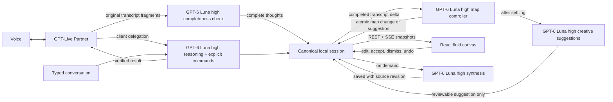

<p align="center">
  
</p>

<p align="center">
  <strong>Think out loud. Watch your ideas take shape.</strong><br />
  A voice-first thinking environment where a conversation becomes a living, explorable map.
</p>

<p align="center">
  Built for <a href="https://openai.devpost.com/">OpenAI Build Week</a> · Apps for your life
</p>

## Team

I built ThoughtForm with my friend and co-contributor/co-submitter, **Hemanth Sammatur**. We worked closely on the architecture and design throughout the project, and used Codex with **GPT-5.6 Sol** as our coding agent for both the frontend and backend.

## The idea

Most thinking tools make you choose: stay in the flow, or stop and organize what you are thinking. Voice AI has the opposite problem. The conversation can feel natural, but every idea is still trapped in a linear transcript.

ThoughtForm is meant to feel more like a visible second working memory. You speak naturally with an AI partner while a map forms alongside the conversation. Completed thoughts become concise bubbles, related ideas connect, and repeated ideas revisit existing bubbles. Their size and text stay stable. Every captured interpretation remains traceable to the exact words that produced it.

The larger idea is a reciprocal loop:

> You think aloud → ThoughtForm captures what you mean → the map reveals structure → ThoughtForm proposes new possibilities → something catches your attention → that changes what you think about next.

It is not a recorder that generates a diagram after the fact. The map is part of the thinking process while it is happening.

## What the current app does

- Holds a voice conversation with a warm, brief AI `Partner` through GPT-Live, with separate mute and end controls.
- Saves original transcript fragments and commits semantically complete thoughts. Partial speech stays in independent user and Partner captions and never rewrites the map.
- Condenses one completed thought into at most three legible bubbles while preserving the full transcript.
- Uses a silent GPT-6 Luna controller at high reasoning effort to create, revisit, edit, connect, and reorganize ideas without delaying the spoken response.
- Commits clear, reversible interpretations directly and turns uncertain or destructive interpretations into ghost suggestions with explicit accept and dismiss controls.
- Links bubbles back to exact transcript spans so the map remains correctable rather than becoming an untraceable AI summary.
- Keeps one underlying graph with switchable organic cluster and hierarchy views.
- Supports direct manipulation: drag, connect, edit, delete, rectangle-select, focus, zoom, undo, and redo.
- Offers new directions as reviewable suggestions after mapping settles. Quiet mode suppresses unsolicited suggestions while conversation and mapping continue.
- Lets you pause mapping, pin a bubble's position, or keep a thought aside from automatic changes.
- Shows recent map changes, groups a controller interpretation into one undo step, and restores the previous view after exploration.
- Keeps conversation, exact sources, suggestions, and synthesis in one resizable panel. Session titles are editable, and each map remembers its browser view.
- Saves written synthesis with its source revision and exports readable Markdown notes or the full JSON session.
- Persists the canonical session as local JSON, including transcript, original fragments, graph, suggestions, preferences, revisions, and activity history.

ThoughtForm has one workspace at `/`. Older `/?mode=session` and `/?mode=classic` bookmarks open this workspace and normalize to the main URL. The separate Classic interface has been retired.

## The two AI streams

ThoughtForm is designed around two related but different kinds of intelligence:

1. **Your thought stream** becomes concise, provenance-linked bubbles. The system organizes what you meant without pretending its interpretation is the original source.
2. **ThoughtForm's idea stream** introduces possibilities that were not already in your words: an analogy, counterexample, question, tension, connection, or new branch.

Both streams are implemented in the primary session. The creative suggestion loop waits 10 seconds after the map controller finishes, reads the eight most recent utterances alongside the map, and may propose one card with at most three operations. It requires three new user turns between evaluations, allows one pending suggestion, and caps creative suggestions at three per session. Producing no suggestion is a valid result. All model activity appears under the single identity `Partner`.

## How it works



The server owns semantic truth. It stores the complete transcript, accepted graph, suggestion state, operation record, and revision history. The browser owns transient physics, deformation, and animation. That separation lets the canvas feel fluid without allowing an old React render or a stale model response to overwrite newer meaning.

The controller uses strict structured output and exact evidence. It can search older transcript context when necessary, but it cannot treat transcript text as instructions or cite speech that occurred after the transcript watermark it was given. Revision checks, idempotent call IDs, suggestion rebasing, and atomic undo protect the map when voice, UI, and background model work arrive concurrently.

GPT-Live does not send an authoritative utterance-completed event. The application preserves its original transcript fragments and asks GPT-6 Luna to identify complete thoughts without rewriting their text. Pauses and audio activity are hints, not completion guarantees. Unfinished speech remains saved for later processing and export. The foreground Partner delegates explicit map commands; automatic mapping and creative suggestions run separately.

## OpenAI technology

### In the product

- GPT-Live `gpt-live-1` runs the foreground voice conversation over WebRTC using client delegation.
- GPT-6 Luna `gpt-6-luna` with high reasoning effort handles delegated reasoning and explicit commands, typed conversation, thought-completion checks, automatic mapping, creative suggestions, and synthesis. These are separate jobs with different permissions and context.
- Structured Outputs and function calling constrain graph mutations, evidence, and suggestion operations. Models remain configurable through environment variables.

Official references: [Live conversations](https://developers.openai.com/api/docs/guides/live-conversations), [client delegation](https://developers.openai.com/api/docs/guides/live-delegation), and [GPT-6 Luna](https://developers.openai.com/api/docs/models/gpt-6-luna).

### In the development process

Hemanth and I used Codex with GPT-5.6 Sol throughout the project as our implementation, debugging, and review partner across both the frontend and backend. The useful part was not code generation by itself. It was being able to turn a fairly opinionated interaction contract into working behavior, inspect it in the browser, find where the boundaries failed, and keep iterating across product design, geometry, state, Realtime events, and server behavior.

Codex accelerated our work on:

- Turning the initial product conversation and visual references into interactive Paper and Nocturne prototypes.
- Building the organic lobe renderer, fused connections, local physics, causal growth and rupture motion, and the canvas gesture system.
- Moving the session model from browser-only prototype state into a server-owned, revisioned local session.
- Implementing the live voice bridge, the map controller, structured operations, SSE updates, provenance validation, suggestion rebasing, and automated tests.
- Running repeated browser QA and adversarial review passes that caught stale snapshots, conflicting revisions, gesture collisions, and cross-boundary Realtime races.

We kept the key product and design decisions explicit. Conversation stays in the foreground, and automatic mapping uses complete thoughts with exact provenance. Clear changes can be direct and reversible; uncertain or destructive interpretations stay reviewable. Semantic state belongs to the server while physical motion belongs to the browser. The final artifact is a thinking map plus synthesis.

## Design principles

- **Do not interrupt thought to document thought.** Mapping should happen quietly around the conversation.
- **Interpretation is not source.** Bubbles can be concise, but the complete transcript and exact provenance remain available.
- **Agency scales with uncertainty.** Clear reversible intent can commit; uncertain or destructive interpretation becomes a suggestion.
- **Motion should explain cause.** Connections grow from a source, contact a target, and rupture from the exact click point. Nothing moves merely to look alive.
- **One graph, multiple views.** Clusters and hierarchy are different ways to inspect the same ideas, not separate documents.
- **Local-first by default.** The hackathon prototype stores session artifacts locally and does not retain raw audio.

## Run locally

### Requirements

- Node.js 22.9 or newer
- npm
- An OpenAI API key for live voice and model-backed mapping
- A modern browser with WebRTC and microphone support

### Setup

```bash
git clone https://github.com/maxrubin629/thoughtform.git
cd thoughtform
npm ci
cp .env.example .env
```

Add your key to `.env`:

```dotenv
OPENAI_API_KEY=sk-...
OPENAI_MODEL=gpt-6-luna
OPENAI_LIVE_MODEL=gpt-live-1
OPENAI_LIVE_BACKEND_MODEL=gpt-6-luna
OPENAI_MAP_CONTROLLER_MODEL=gpt-6-luna
THOUGHTFORM_MAP_CONTROLLER_ENABLED=true
OPENAI_CURATOR_MODEL=gpt-6-luna
THOUGHTFORM_CURATOR_ENABLED=true
PORT=8787
```

Start the API and Vite app together:

```bash
npm run dev
```

Open [http://127.0.0.1:5173](http://127.0.0.1:5173), allow microphone access, and start with any unresolved idea.

The API key stays on the local server. Without a valid key, you can inspect saved maps and use manual canvas controls, but voice, typed Partner replies, automatic mapping, creative suggestions, and synthesis are unavailable. Local sessions are written to `data/sessions/` and are intentionally ignored by Git. Set `THOUGHTFORM_DATA_DIR` to use another session directory. Schema upgrades preserve a backup of the original session file.

### Useful commands

```bash
npm run dev          # API + frontend development servers
npm run dev:client   # frontend only
npm run build        # production build
npm run preview      # preview the production build
npm test             # automated unit and integration tests
```

Tests cover transcript preservation, Live transport and delegation, graph operations, concurrency, persistence, and canvas behavior. A synthetic-silence WebRTC smoke check has verified GPT-Live connection, mute, unmute, and close; an earlier Terra call verified the completeness-check contract before the GPT-6 Luna switch. Those checks do not establish spoken conversation quality or microphone performance.

## Browser-local example

The example opens the same organic canvas with an illustrative conversation about a neighborhood reading room. It needs no API server, API key, account, or paid model call. Voice and AI generation are off and labeled as such; the sample is authored content, not a recording of a real conversation.

```bash
npm run dev:example       # frontend only
npm run build:example     # static files in dist-example/
npm run preview:example   # preview that static build
```

The normal development app also exposes the example at `/example` or `/?example=1`. `/` continues to use the live server. Old Classic/session bookmarks still normalize as before.

Each browser keeps its own example copies in IndexedDB. You can edit and connect thoughts, inspect exact source spans, accept or dismiss the saved suggestion, undo and redo, and reopen maps after a reload. Maps offers **New example copy**, which keeps previous copies, and **Import full session**. JSON export includes the complete transcript and reversible history; importing it creates a new copy and preserves its undo/redo branch. Markdown export contains the readable map, synthesis, and sources. Clearing browser data removes local copies, so export JSON to keep an independent backup.

The live server and example share `shared/sessionSchema.mjs`, `shared/sessionOperations.mjs`, `shared/sessionSnapshot.mjs`, and `shared/sessionExport.mjs`. The example persists full canonical records and projects display snapshots only for rendering. The live server retains its local JSON store, background controllers, and SSE transport.

`npm test` includes recovery and example-operation regression tests. With the example dev server running, `/test/example-browser.html` runs checks against real IndexedDB, including reopen, JSON round trips, concurrent writes, and transaction rollback. This development test page is excluded from the production build.

Typed-message retries retain their submission ID if the message was saved but Partner failed. Speech-completion failures use bounded retries and expose **Retry thought capture** after a failure; unfinished speech still requires semantic completion.

## Built with

- React 19 and Vite 6
- Express 5
- OpenAI JavaScript SDK
- OpenAI Responses API
- OpenAI Live API over WebRTC
- Server-Sent Events
- Canvas 2D and WebGL2
- Tabler Icons and Manrope
- Local JSON persistence with atomic writes

## Challenges we ran into

### Keeping conversation and mapping independent

The fastest voice response and the best map update do not have the same timing. Making one model responsible for both creates awkward speech, tool preambles, and pressure to update the map from partial thoughts. The solution was to split the foreground GPT-Live partner from the silent GPT-6 Luna controller and let them meet at the canonical transcript.

### Preserving one source of truth without making the canvas feel rigid

The map needs revision checks and durable history, but the bubbles also need to stretch, wobble, collide, and follow the pointer without round-tripping every frame through a server. Separating semantic state from transient physical state was the key architectural decision.

### Making autonomy feel safe instead of timid

If every model action needs confirmation, the user becomes the system's project manager. If the model freely rewrites accepted ideas, the map stops feeling like the user's thinking. Confidence-gated autonomy created a better boundary: direct and reversible when intent is clear, visible and reviewable when interpretation matters.

### Building an organic interface with exact interactions

The connected lobes are not cards with lines between them. They are one continuous material whose geometry has to remain draggable, selectable, editable, collision-aware, and causally animated. A lot of the work was not drawing the shape once; it was preserving that visual language across every interaction and state transition.

## Accomplishments we're proud of

- A real conversation-first session rather than a scripted voice mockup.
- A server-owned semantic graph with append-only transcript, exact source spans, revisions, suggestions, activity history, and reversible map edits.
- A silent controller that can work after each completed utterance without slowing or narrating the conversation.
- Reviewable ghost operations that can rebase against a newer map and drop invalid or duplicate changes safely.
- A visual system where the interaction model and the product idea are the same thing: ideas feel distinct, connected, movable, and alive without becoming visually noisy.

## What we learned

The important boundary is not simply which model is more capable. It is which model is allowed to act, on what evidence, and at what moment.

The voice model protects conversational flow. The reasoning model works over the semantic state without needing to speak. The canonical session lets those jobs contribute to one product without competing to control the map.

We also learned that provenance changes the experience more than we expected. Once a bubble can reveal the exact moment it came from, aggressive condensation becomes much safer because the user's original meaning is never gone.

## What's next

- Evaluate GPT-Live with real spoken sessions, especially interruptions, corrections, overlapping speech, and long thinking pauses.
- Package the experience as the intended local-first Electron app.
- Add multi-speaker sessions and diarization after the solo thinking loop is stable.
- Add end-of-session consolidation and richer synthesis without turning ThoughtForm into an action-plan generator.
- Validate the real success criterion: whether people discover useful structure or a direction they would not have reached without seeing the map evolve.

## Build Week scope

ThoughtForm's repository, interaction system, canonical session architecture, OpenAI integrations, and primary conversation-first experience were created during the OpenAI Build Week submission period by Max Rubin and Hemanth Sammatur, working with Codex and GPT-5.6 Sol.

The GPT-Live/Terra migration and the workspace controls described above extend that original build.
