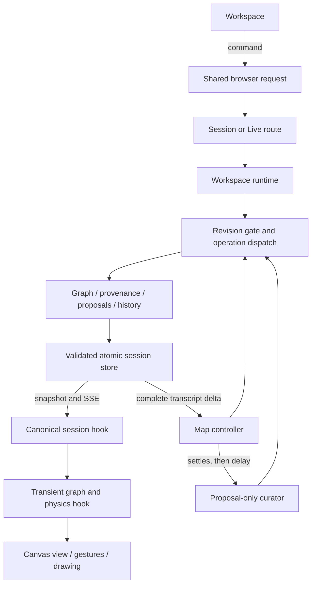

# Code map

ThoughtForm has one workspace, one voice transport, and one canonical session reducer. The server owns semantic state. The browser owns camera, selection, and transient physics.

## Start here

| Change | Start in | Responsibility |
| --- | --- | --- |
| Workspace composition | `src/workspace/Workspace.jsx` | Connect session, graph, voice, view, and editor state to the UI |
| Loading and writing sessions | `src/workspace/useCanonicalSession.js` | REST/SSE reconciliation, revision ordering, pending writes |
| Thought drafts | `src/workspace/useThoughtEditor.js` | Distinct creation, editing, and failed-submit recovery |
| Map library | `src/workspace/useMapLibrary.js` | Create, rename, switch, and delete commands |
| Camera and view history | `src/workspace/useWorkspaceView.js` | Per-map browser preferences and return-to-previous-view state |
| Physics and proposal placement | `src/workspace/useSessionGraph.js` | Authoritative local node positions and causal connection motion |
| Canvas input | `src/canvas/useCanvasGestures.js` | Lock each pointer gesture to move, connect, select, or pan |
| Canvas drawing | `src/canvas/useCanvasRenderer.js` | Canvas/WebGL rendering lifecycle |
| Material geometry | `src/canvas/bridgeGeometry.js`, `src/canvas/nodeMotion.js` | Fused neck geometry and directional deformation |
| Drawer contents | `src/workspace/WorkspaceDrawer.jsx` | Named panel registry and panel components |
| Browser requests | `src/apiRequest.js` | Paths, response decoding, and typed errors shared by all clients |
| Live voice | `src/sessionLive.js` | WebRTC connection, acknowledgements, delegation, and shutdown |
| Unsaved speech | `src/live/transcript.js` | Durable fragment outbox, retry, and caption reconciliation |
| Server startup | `server/index.mjs` | Construct the app and register routes |
| Server coordination | `server/workspaceRuntime.mjs` | Session operations, UI context, controller and curator coordination |
| HTTP endpoints | `server/sessionRoutes.mjs`, `server/live.mjs` | Canonical session and GPT-Live routes |
| Canonical changes | `server/sessionOperations.mjs` | Immutable operation transaction and revision gate |
| Graph operations | `server/session/graph.mjs` | Named graph-operation handlers |
| Sources and proposals | `server/session/provenance.mjs`, `server/session/proposals.mjs` | Exact source spans and acceptance-time rebase |
| Undo and activity | `server/session/history.mjs` | Reversible deltas, replay, and actor records |
| Persistence | `server/sessionStore.mjs`, `server/sessionSchema.mjs` | Serialized atomic writes, validation, and migration backups |
| Automatic mapping | `server/mapController.mjs`, `server/mapControllerDecision.mjs` | Model interpretation and atomic decision application |
| Background scheduling | `server/mapControllerScheduler.mjs`, `server/curatorScheduler.mjs` | Single-flight work, cancellation, retry, and downstream suggestion timing |

## Follow a change

An operation is validated before its cloned session changes. The operation handlers return affected entities and warnings; the transaction records a revision and one undo step. The store serializes writes per session and persists only validated results. REST and SSE deliver the same public snapshot shape.

`useSessionGraph` owns live positions through refs. React receives a display snapshot; rendering never writes that snapshot back over the simulation. Proposal motion remains local until an accepted operation changes the canonical map.

Speech fragments first enter the browser outbox. GPT-Live transport events do not establish semantic completeness. The server saves original fragments, validates completed thoughts, and schedules mapping. The curator can run only after that primary work settles and still creates proposals only.

## Shared contracts

- `server/aiProtocol.mjs` constructs strict JSON schemas. `server/mapTools.mjs` defines the map tools used by the foreground reasoning backend and proposal schema consumers.
- `server/session/operationInput.mjs` centralizes operation names, errors, IDs, and target resolution. Operation registries are `Map` instances, so arbitrary object-property names cannot become handlers.
- `src/canvas/geometry.js` supplies the same segment-distance calculation to hit testing, lasso selection, and physics. `src/canvas/viewport.js` owns world dimensions, zoom limits, and transforms.
- `src/session/connectionMotion.js` owns edge identity and causal growth/pop transitions. Canvas and workspace code consume that implementation.
- `src/styles.css` imports styles in cascade order. The files separate foundations, controls, panels, theme overrides, session content, and workspace layout. Keep that order when moving selectors.

## What was retired

The unused Classic client, simulated conversation/curation, old Realtime WebRTC client, old SDP/tool-call HTTP routes, and their dedicated tests are gone. The current GPT-Live workflow remains. Existing session schema migrations and operation aliases needed to read saved data remain.

The early `designs/fluid-bubble-poc` executable is archived in Git history; its notes and visual evidence remain. The separate `sites/fluid-bubble-lab` reference is unchanged.

## Verify a change

Run `npm test` and `npm run build`. For browser checks, start `npm run dev`; use a separate `THOUGHTFORM_DATA_DIR` when creating disposable maps. Exercise create/edit, connect/pop/undo, selection, view changes, and drawer interactions after changing canvas or workspace code.

`npm run stats -- <base-commit>` reports source-line counts by application, tests, prototype, and tooling. It also supports `--json`. Counts include comments and blank lines, exclude lockfiles, generated output, images, and QA snapshots, and report nonblank counts separately in JSON. The pre-refactor working-state baseline is `bdf935f`.
